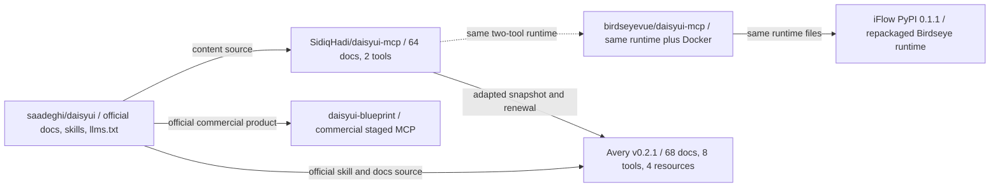

# MCP Genesis: DaisyUI MCP lineage and capability comparison

**Research snapshot:** 2026-09-22  
**Scope:** `SidiqHadi/daisyui-mcp`, `birdseyevue/daisyui-mcp`,
`iflow_mcp_birdseyevue_daisyui_mcp`, this repository, and the official
`daisyui-blueprint` product.

This report compares public repository contents, published package metadata,
source files, and official DaisyUI documentation. It does not inspect private
Blueprint implementation code.

## Executive summary

- The original open-source runtime lineage is a small, token-friendly,
  two-tool server with a 64-document component snapshot. SidiqHadi's current
  repository and birdseyevue's repository share that runtime; birdseyevue adds
  Docker packaging and documentation rather than new MCP behavior.
- The iFlow PyPI release is a distribution of the birdseyevue runtime, not an
  independently evolved implementation. Its published executables are
  byte-identical to birdseyevue's corresponding files.
- This repository's `v0.2.1` is the first clearly substantive divergence: it
  packages a typed Python runtime, expands the bundled catalog to 68 current
  components, exposes eight tools and four resources, and adds search, skills,
  refresh, cache, status, CLI, and Codex profile workflows.
- Blueprint is a separate official, paid MCP product. It is a higher-level
  workflow system for project setup, design direction, page architecture,
  conversion, component retrieval, and quality inspection. It should not be
  described as equivalent to the open-source documentation servers.

## Evidence conventions

Statements in this report are marked as:

- **Fact** — directly observed in a repository, package, or official page.
- **Inference** — a reasoned conclusion from those observations.
- **Vendor claim** — a claim published by the Blueprint site that is not an
  independently reproduced benchmark.

The grades are comparative engineering judgments, not an externally validated
benchmark. No open-source project in this comparison publishes token-use
measurements.

## Project evolution

The editable canonical diagram is [`mcp-genesis.mermaid.json`](mcp-genesis.mermaid.json).
The diagram expresses content and repository lineage, not guaranteed shared Git
object ancestry. GitHub identifies this repository as a fork of SidiqHadi's
repository, while the local renewal snapshot does not have a directly
resolvable Git merge-base with the currently configured upstream.

## Attribution and provenance

The names in this lineage should not be collapsed into one authorship claim:

1. **birdseyevue** appears in the initial implementation history and in the
   `Copyright (c) 2025 birdseyevue` notice in the original MIT license. The
   visible two-tool implementation is therefore best described as the
   birdseyevue-origin runtime.
2. **Sidiq Hadi Firmasyah** owns and maintains the current
   [`SidiqHadi/daisyui-mcp`](https://github.com/SidiqHadi/daisyui-mcp)
   repository and has pushed later README updates. That repository history
   alone does not establish that SidiqHadi wrote the original runtime.
3. **Avery Freeman** substantially renewed the runtime in this repository.
   The current local [`LICENSE`](LICENSE) uses an Avery copyright notice, so
   future redistribution should preserve the original MIT attribution and add
   any new copyright line rather than obscuring upstream provenance. This is a
   provenance recommendation, not legal advice.
4. The official Codex instructions point to
   [`saadeghi/daisyui`](https://daisyui.com/docs/plugin/codex/). That confirms
   Saadeghi as the official DaisyUI plugin/skill source; it does not establish
   SidiqHadi as the original author of the MCP server.

## What materially diverged

### Original two-tool lineage

**Fact:** The SidiqHadi source exposes `list_components` and `get_component`.
`update_components.py` downloads the official `llms.txt` document and splits it
into local Markdown files. The repository contains 64 component documents.

Sources: [`mcp_server.py`](https://raw.githubusercontent.com/SidiqHadi/daisyui-mcp/main/mcp_server.py), [`update_components.py`](https://raw.githubusercontent.com/SidiqHadi/daisyui-mcp/main/update_components.py), and the [SidiqHadi repository](https://github.com/SidiqHadi/daisyui-mcp).

**Fact:** The current birdseyevue tree changes the baseline with a
`Dockerfile`, `docker-compose.yml`, README revisions, and removal of two
archived ZIP files. Its `mcp_server.py` and `update_components.py` hashes match
the SidiqHadi runtime.

**Conclusion:** Birdseyevue is operationally easier to containerize, but it is
not a substantive MCP API fork. Per the filtering rule for this report, it is
not graded as a separate feature implementation below.

### iFlow PyPI distribution

**Fact:** The `0.1.1` wheel contains root-level `mcp_server.py`,
`update_components.py`, and the same 64 component files. Its two executable
file hashes match birdseyevue's files, and it has no independent console
command or expanded MCP surface.

Source: [iFlow PyPI metadata and release](https://pypi.org/project/iflow_mcp_birdseyevue_daisyui_mcp/).

**Inference:** iFlow is a packaging/distribution convenience for the birdseyevue
runtime. It inherits the baseline grade and is not a separately evolved code
project.

### Avery v0.2.1 renewal

The current package makes several substantive changes:

- A typed `src/daisyui_mcp` package with normal wheel, `uv`, and `pip`
  installation paths.
- A 68-document packaged component catalog, adding `aura`, `megamenu`, `otp`,
  and `tooltip` relative to the 64-document baseline. The count matches the
  current official component inventory in [`daisyui/llms.txt`](https://daisyui.com/llms.txt).
- Eight tools: `list_components`, `get_component`, `search_daisyui`,
  `list_skills`, `get_skill`, `refresh_daisyui`, `install_daisyui_skills`, and
  `daisyui_status`.
- Four resources: `daisyui://components`, `daisyui://skills`,
  `daisyui://install`, and `daisyui://status`.
- A content-store boundary with bundled content, user-cache persistence,
  network refresh, and bundled fallback after refresh failure.
- Official skill discovery and project-local skill installation, sourced from
  the [DaisyUI skill tree](https://github.com/saadeghi/daisyui/tree/master/skills/daisyui).
- CLI commands for serving, skills, refresh, status, and installing a Codex
  profile template.

Source: the [Avery server implementation](https://github.com/averyfreeman/daisyui-mcp-for-uv-pip/blob/v0.2.1/src/daisyui_mcp/server.py) and [package metadata](https://github.com/averyfreeman/daisyui-mcp-for-uv-pip/blob/v0.2.1/pyproject.toml).

## Comparative grades

### Rubric

- **1/5:** absent, inaccessible, or unsupported.
- **3/5:** useful baseline capability with material manual limitations.
- **5/5:** strongest capability in this comparison, with the evidence or
  qualification stated.

Attribute 1 measures DaisyUI content and ability coverage. Attribute 2 is
broken into agent accessibility, API surface, and token efficiency so the
tradeoffs remain visible.

| Project | Attribute 1: feature completeness | Agent accessibility | API surface | Token efficiency | Interpretation |
| --- | ---: | ---: | ---: | ---: | --- |
| SidiqHadi baseline | 3/5 | 2/5 | 2/5 | 3/5 | Useful two-tool retrieval, 64 components, manual runtime setup. |
| birdseyevue | inherited 3/5 | inherited 2/5 | inherited 2/5 | inherited 3/5 | Docker improves deployment, not MCP behavior. |
| iFlow | inherited 3/5 | inherited 3/5 | inherited 2/5 | inherited 3/5 | PyPI distribution convenience without a new API. |
| Avery v0.2.1 | 4/5 | 4/5 | 4/5 | 4/5 | Broadest open-source surface, current 68-component bundle, and better installation/discovery. |
| Official Blueprint | 5/5* | 4/5* | 5/5* | 5/5* | Broadest workflow coverage, but paid access and private implementation limit verification. |

The Blueprint row is a separate commercial benchmark, not a claim that its
private server is source-compatible with Avery.

### Attribute 1: DaisyUI feature completeness

Among the open-source documentation servers, Avery is the most complete because
its packaged content matches the current 68-component official snapshot and it
also exposes the official skills, refresh path, installation path, and status.
It is not a complete substitute for Blueprint's project-level design workflow:
it does not inspect a project, convert Figma/screenshots/Bootstrap/Tailwind,
or run Blueprint's advertised visual quality gate.

Blueprint receives the highest breadth grade only because its official workflow
description covers more kinds of outcomes than component documentation. Its
score is qualified by the fact that the public repository exposes descriptors
and installation configuration, not the complete server implementation.

### Attribute 2: agent accessibility, API surface, and tokens

- The baseline `list_components` plus `get_component` API is easy to explain and
  supports narrow on-demand retrieval, but agents must perform more manual
  installation and have no search, status, resource, or skill abstraction.
- Birdseyevue's Docker support improves operator accessibility but leaves tool
  selection and response size unchanged.
- iFlow improves package acquisition but does not add a console entry point or
  change the runtime contract.
- Avery adds search and resource indexes that can reduce unnecessary full
  document reads, plus an installable skill tree. The larger eight-tool surface
  creates some tool-selection overhead, so the 4/5 token grade is a structural
  estimate rather than a measured result.
- Blueprint's documented staged workflow is designed to reduce agent
  backtracking and context waste. Its advertised token advantage is a vendor
  claim, not an independently reproduced measurement.

## Blueprint versus the open-source offerings

| Capability | Sidiq/birdseye/iFlow | Avery v0.2.1 | Official Blueprint |
| --- | --- | --- | --- |
| Component documentation | 64 local Markdown documents | 68 packaged documents plus refresh | 68-component workflow stage, according to official product documentation |
| Agent interaction | Two tools: list and retrieve | Eight tools plus four resources | Commercial staged MCP workflow; exact private schemas are not public |
| Project setup/inspection | No | No general project inspection | Yes, documented Setup Expert and Rules Enforcer stages |
| Design direction/page architecture | No | No | Creative Director and Page Architect stages |
| Conversion workflows | No | No | Figma, Tailwind, Bootstrap, screenshot, and image-to-theme workflows are documented |
| Final quality gate | No | Status/freshness only | Quality Inspector stage is documented |
| Distribution | Manual checkout or repackaging | `uv`/`pip` package and CLI | `npx daisyui-blueprint@latest` with license configuration |
| Cost/access | Open source | Open source | License key and email required; pricing is listed on the official site |

The official Blueprint page documents six sequential roles: Setup Expert, Rules
Enforcer, Creative Director, Page Architect, Component Syntax Expert, and
Quality Inspector. It also advertises 168 rules/principles, 211 page
architectures, 68 components, and conversion workflows. These are official
product descriptions; they should be cited as such rather than presented as
independently audited counts.

The public [Blueprint MCP manifest](https://github.com/saadeghi/daisyui/blob/master/packages/blueprint/mcp.json) shows an npm-launched server with
`LICENSE`, `EMAIL`, and optional `FIGMA` environment variables. The free
[Codex plugin instructions](https://daisyui.com/docs/plugin/codex/) are a
separate official skill-installation path and do not provide Blueprint's
orchestration or inspection workflow.

## Saadeghi repositories useful to this project

| Repository | Potential value | Recommendation |
| --- | --- | --- |
| [`saadeghi/daisyui`](https://github.com/saadeghi/daisyui) | Canonical CSS, themes, current `llms.txt`, official skills, Codex plugin, and public Blueprint descriptors | Keep as the only authoritative content source; pin or test synchronization rather than vendoring the entire JavaScript project. |
| [`saadeghi/ui-skills`](https://github.com/saadeghi/ui-skills) | General UI, accessibility, metadata, and motion/performance guidance | Optional future skill integration; keep separate from DaisyUI component content. |
| [`saadeghi/theme-change`](https://github.com/saadeghi/theme-change) | Theme switching and persistence implementation reference | Useful optional runtime/example reference, not a required MCP dependency. |
| [`saadeghi/daisyui-images`](https://github.com/saadeghi/daisyui-images) | Component preview imagery | Reference by URL only until asset licensing and redistribution intent are clear. |
| [`saadeghi/tailwindcss-document-cli`](https://github.com/saadeghi/tailwindcss-document-cli) | Fuzzy Tailwind utility documentation lookup | Inspiration for a future utility-search tool; it is a separate Node CLI, not a DaisyUI package dependency. |
| [`saadeghi/design-systems`](https://github.com/saadeghi/design-systems) | Design-system reference links | Research-only reference; not a runtime package. |

The practical packaging choice is therefore to keep the official DaisyUI skill
and component snapshots synchronized, while exposing optional repositories as
links or opt-in integrations. Blueprint should remain a separately licensed
product rather than being bundled as if it were open-source content.

## Recommendations

1. Keep `saadeghi/daisyui` as the canonical upstream and add synchronization
   checks for component names, skill files, and source revision.
2. Preserve upstream MIT attribution in future package/license edits and keep
   the report's provenance language explicit.
3. Describe Avery's project as a free documentation, skills, and retrieval MCP;
   do not promise Blueprint's project-planning, conversion, or inspection
   capabilities unless they are independently implemented.
4. Treat token savings as a hypothesis to benchmark. Record representative
   agent tasks and compare list/retrieve, search/retrieve, resource, and skill
   workflows before making quantitative claims.
5. Revisit `ui-skills` and `theme-change` as optional integrations only when a
   concrete user workflow needs them. Do not vendor assets with unclear
   redistribution terms.

## Source index

- [SidiqHadi/daisyui-mcp](https://github.com/SidiqHadi/daisyui-mcp)
- [birdseyevue/daisyui-mcp](https://github.com/birdseyevue/daisyui-mcp)
- [iflow_mcp_birdseyevue_daisyui_mcp on PyPI](https://pypi.org/project/iflow_mcp_birdseyevue_daisyui_mcp/)
- [Avery Freeman's daisyui-mcp-for-uv-pip](https://github.com/averyfreeman/daisyui-mcp-for-uv-pip)
- [Official DaisyUI documentation](https://daisyui.com/docs)
- [Official DaisyUI `llms.txt`](https://daisyui.com/llms.txt)
- [Official DaisyUI skill documentation](https://daisyui.com/docs/skill/)
- [Official Codex plugin documentation](https://daisyui.com/docs/plugin/codex/)
- [Official Blueprint](https://daisyui.com/blueprint/)
- [Saadeghi repository list](https://github.com/saadeghi?tab=repositories)
